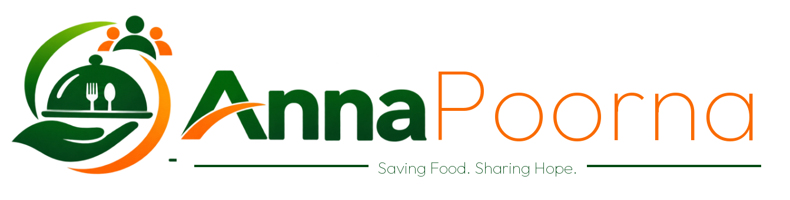

# AnnaPoorna — Saving Food. Sharing Hope.

**AnnaPoorna** is a production-grade, single-file food donation, distribution, and rescue network application. It connects food donors (senders), non-profit receivers (shelters, orphanages, community kitchens), distributors (courier/volunteer networks), and administrative officials to eliminate food wastage and combat hunger across India.

---

## 🌟 Key Capabilities

- **Single Unified UI & Multilingual Engine:** Full live language switching without page reloads across **8 Indian regional languages**:
  - English (`en`)
  - हिन्दी / Hindi (`hi`)
  - ગુજરાતી / Gujarati (`gu`)
  - বাংলা / Bengali (`bn`)
  - मराठी / Marathi (`mr`)
  - தமிழ் / Tamil (`ta`)
  - తెలుగు / Telugu (`te`)
  - മലയാളം / Malayalam (`ml`)
- **100% Internationalization Parity:** 645 master localization keys with zero untranslated fallbacks, preserving proper brand names (**AnnaPoorna**, **FSSAI**, **OTP**).
- **Interactive Story & Odyssey:** Highlights India's food waste statistics and mission context.
- **Role-Based Portals:**
  1. **Sender Portal:** Food donor dispatch dashboard, AI dish preset detector, portion splitting optimizer.
  2. **Receiver Portal:** Claim donations, view nutritional distribution, monitor inbound couriers.
  3. **Distributor / Volunteer Portal:** Route management, live GPS tracking, delivery proof verification.
  4. **Official / Admin Console:** FSSAI compliance verification, dispute resolution, impact metrics.
- **Smart Safety & Portion Optimizer:** Automated splitting of bulk banquet donations into standard meal kits for individual shelter capacity.

---

## 🚀 Live Demo & Access

Visit the live deployment directly in your phone or desktop browser:
- **Live URL:** [https://tirth080904-cse.github.io/annapoorna/](https://tirth080904-cse.github.io/annapoorna/)

---

## 📄 License

Open-source under the MIT License.
